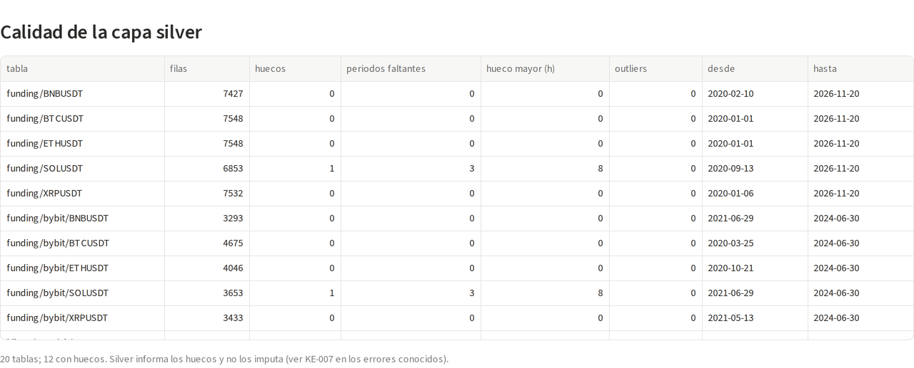
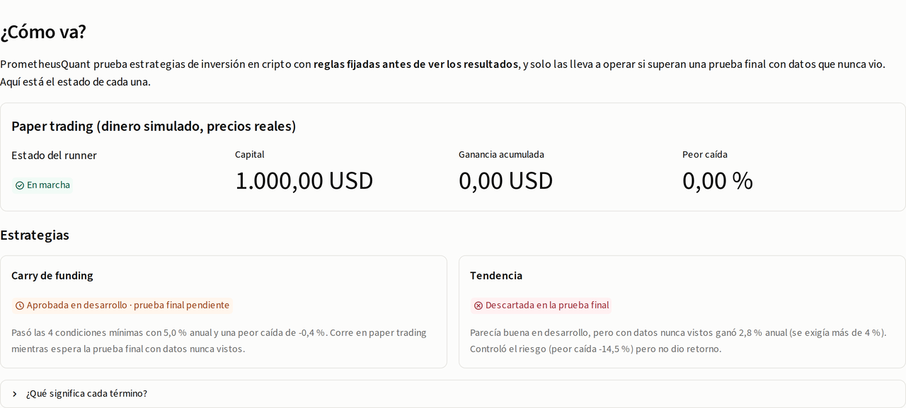

# Auditoría de UX y rediseño del dashboard (PQ-124)

- **Fecha:** 2026-11-23.
- **Motivo:** el titular observó que el dashboard «no tiene mucho color, ni se ve muy
  profesional». Además, él mismo no podía resolver las tareas de la
  [prueba de usabilidad](prueba-de-usabilidad.md). Eso ya es un hallazgo: el tablero estaba
  pensado para quien lo programó, no para el jurado ni para usuarios no técnicos.
- **Método:** se siguieron las skills `ux-audit` (lista de verificación previa de VectorLab) y
  `design-critique` (primera impresión, usabilidad, jerarquía, consistencia y accesibilidad), más
  la skill `dataviz` para gráficos y color.
- **Evidencia:** capturas de las 9 pestañas antes y después, tomadas con
  `scripts/capture_dashboard.py` en un navegador real (Chromium sin ventana), en
  `docs/academico/img/ux-antes/` y `docs/academico/img/ux-despues/`.
- **Perfil:** el proyecto no tiene `.ux-profile.md`, así que se usaron los valores por defecto del
  catálogo: estética sobria, WCAG 2.1 AA y voz utilitaria.

## Primera impresión (2 segundos)

| | Antes | Después |
|---|---|---|
| Lo primero que se ve | Una tabla de calidad de datos (20 filas de huecos y outliers) | «¿Cómo va?»: el paper trading en marcha y el estado de cada estrategia |
| ¿Se entiende el propósito? | No: hay que saber qué es «la capa silver» | Sí: una frase explica qué hace la plataforma |
| Reacción | Herramienta interna de ingeniería | Panel de control de un producto |

## Hallazgos y qué se hizo

| # | Hallazgo (antes) | Severidad | Qué se hizo |
|---|---|---|---|
| 1 | No había portada: se abría en la tabla técnica de calidad | 🔴 Crítico | Pestaña nueva **«Inicio: ¿cómo va?»** (patrón *Dashboard*): estado del paper y una tarjeta por estrategia con su veredicto en lenguaje simple. La calidad de datos pasa al final como «(técnico)» |
| 2 | Jerga sin explicar: gates, CPCV, Deflated Sharpe, PBO, S_k, `max_drawdown` | 🔴 Crítico | Métricas con nombre en español y una columna «qué significa». Ayudas al pasar el cursor en PBO y Deflated Sharpe. Glosario desplegable en la portada |
| 3 | Cifras crudas: `0.1486`, `16.3182`, `+0.0000 USD`, punto decimal en inglés | 🟡 Moderado | Formato español en todas partes (`1.234,50 USD`, `14,9 %`), con decimales según la magnitud |
| 4 | Fechas de los ejes en inglés («Sat 14», «12 PM», «April») | 🟡 Moderado | Locale de Vega en español en el tema de Altair (`ene`, `abr 2024`) |
| 5 | Veredictos como texto «sí/no» sin señal visual | 🟡 Moderado | «✅ pasa / ❌ no pasa» en las tablas. En la portada, insignias de Streamlit con icono, texto y color, que nunca dependen solo del color y funcionan sin internet |
| 6 | Tema por defecto de Streamlit, sin color de marca ni superficies: la regla 60-30-10 falla porque la parte estructural era casi 0 % | 🟡 Moderado | Tema propio (`.streamlit/config.toml`): azul de marca de la paleta validada, fondo cálido, bordes finos y radio suave. Tarjetas con borde en la portada |
| 7 | Gráfico del paper con el eje Y desde 0: la curva parecía una línea plana | 🟡 Moderado | Eje sin cero, línea de 2 px en el color de marca, referencia «esperado» en gris punteado, leyenda arriba y tooltip |
| 8 | Texto desactualizado: «El holdout sigue cerrado hasta verificar comisiones» (PQ-17 ya está hecho) | 🟢 Menor | Texto actualizado |
| 9 | La tendencia (evaluada y descartada) no aparecía en ningún lado | 🟢 Menor | Tarjeta en la portada con su resultado en el holdout |

## Lista de verificación (`ux-audit`)

Puerta obligatoria (*hard gate*):

| # | Comprobación | Resultado | Evidencia |
|---|---|---|---|
| 1 | Nada de la lista de anti-estética (gradientes arcoíris, glassmorphism, ilustraciones) | ✅ | Solo colores planos de la paleta |
| 2–4, 6 | Modales, renombrar, borrado destructivo, validación de formularios | n/a | El dashboard es de solo lectura |
| 5 | Textos con verbo al inicio y sin culpar al usuario | ✅ | Los estados vacíos dicen qué comando genera el dato |
| 7 | Movimiento solo con transform y opacity | n/a | Sin animaciones propias |
| 8 | Cada página nombra su patrón | ✅ | Portada: *Dashboard*. Pestañas de análisis: *Analytics* |
| 9 | Sin desbordes horizontales a 375 px | ⚠️ sin probar | Streamlit apila las columnas en pantallas estrechas; la captura a 375 px queda pendiente |
| 10 | Acabado visual | ✅ | Capturas del después: tablas en marco con bordes y tarjetas en superficie con borde |

Skills de dominio:

| Skill | Resultado | Evidencia |
|---|---|---|
| `colour-palette` | ✅ | Un acento (azul de marca). Los neutros llevan el resto. Superficies con borde de 1 px y sin sombras duras |
| `typography` | ✅ | Pesos 400 y 600, ninguno por encima de 700 (`headingFontWeights`). El contenido de las tablas va a 14 px o más |
| `page-patterns` | ✅ | Portada *Dashboard*: tarjetas de cifras y estado, sin reemplazar el patrón |
| `empty-states` | ✅ | Cada artefacto faltante dice qué falta y con qué comando se genera |
| `anti-slop` | ✅ | Sin pastillas decorativas. El estado usa insignias funcionales |
| `labels`, `forms` | ✅ | El simulador ya tenía etiquetas visibles en sus controles |
| `viewports` | ⚠️ sin probar | Ver puerta 9 |
| `motion`, `keyboard`, `surfaces` | n/a | Sin animaciones, atajos ni diálogos propios |

## Color y gráficos (`dataviz`)

- **Paleta categórica:** la de referencia de la skill. Los tres primeros colores (azul, naranja,
  aguamarina) están validados para daltonismo y contraste en modo claro y oscuro. Se asignan
  siempre en el mismo orden.
- **Benchmarks y referencias en gris neutro,** para que no compitan con la serie principal.
- **Tema de Altair** (`api/dashboard/style.py`):
  - rejilla y ejes discretos;
  - sin rejilla vertical;
  - líneas de 2 px;
  - leyenda arriba;
  - números y fechas en español.
- **Todos los gráficos rediseñados** se dibujan con `theme=None` para que manden el tema propio y
  la paleta.

## Pendiente (siguiente iteración)

1. **Captura a 375 px** (móvil) para cerrar las puertas 9 y `viewports`.
2. ~~Unificar los gráficos que aún usan los de Streamlit por defecto.~~ **Hecho (2026-11-24):**
   - el simulador, la importancia de variables, el capital por exchange y las bandas de la cartera
     usan el tema propio;
   - las barras son finas, en el color de marca, con tooltip;
   - las etiquetas largas van en horizontal;
   - el paper va en azul y el backtest en gris.
3. **Prueba de usabilidad con 3 personas (PQ-76) sobre esta versión.** La pestaña inicial del guion
   ya se actualizó a la portada.
