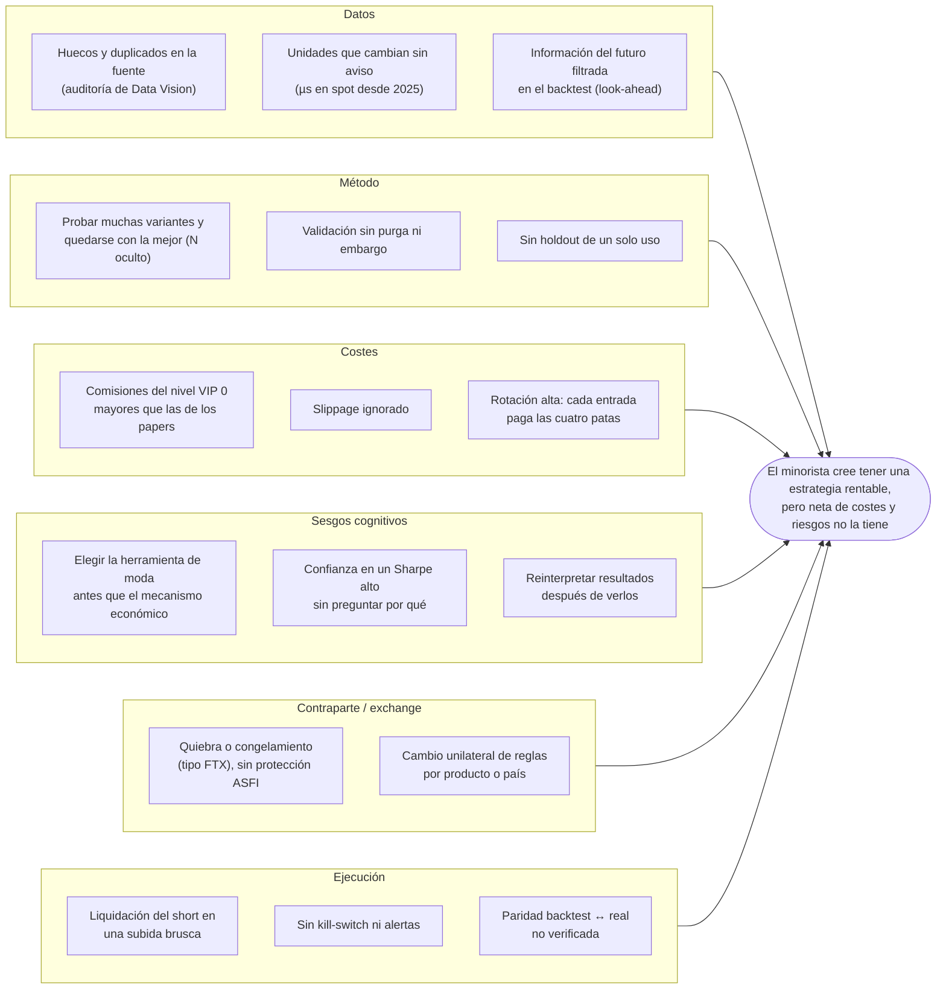

# Planteamiento del problema (capítulo 1.2–1.4)

**Proyecto Integrador · Capítulo 1** · **Ticket:** PQ-45 · **Épica:** PQ-2 · **Fecha:** 2026-11-06

Este documento reúne cuatro herramientas que pide el capítulo 1:

- el **diagrama de Ishikawa** (1.2);
- la **matriz de consistencia** (1.3);
- el **registro de supuestos** (1.4);
- la **matriz de riesgos**.

No repite la evidencia. Cada cifra apunta al documento del repositorio de donde sale. El contexto
regulatorio y de mercado está en la
[investigación base](../investigacion/2026-10-16-plataforma-multiestrategia.md); la hipótesis y su
protocolo, en el [pre-registro del carry](../estrategias/01-carry/pre-registro.md).

## 1.2 Análisis de causas: por qué un minorista pierde dinero o se engaña con estrategias algorítmicas en cripto

### Diagrama de Ishikawa

El efecto que se analiza es el de la cabeza del pescado: **el minorista cree tener una estrategia
rentable, pero neta de costes y de riesgos no la tiene**, o la abandona tras perder dinero. Las seis
ramas agrupan las causas encontradas en la investigación y en nuestro propio trabajo.

| Rama | Causa | Evidencia en el repositorio |
|---|---|---|
| Datos | La fuente pública tiene huecos, duplicados y cambios de unidades | [Auditoría de Data Vision](../investigacion/2026-10-23-auditoria-binance-data-vision.md): duplicados en `metrics` 2020–2021 y timestamps en µs en spot desde 2025. KE-007: días ausentes en el perp de SOL y XRP en 2022 ([KEDB](../runbooks/errores-conocidos.md)) |
| Método | Probar variantes sin contarlas infla el Sharpe | [Pre-registro](../estrategias/01-carry/pre-registro.md) §5 y §8: N declarado, CPCV, Deflated Sharpe y PBO |
| Costes | Los costes reales del minorista superan a los de la literatura | Pre-registro §2: el paper de referencia usa 1,44 pb en futuros frente a 5 pb del taker VIP 0; la ida y vuelta de las cuatro patas cuesta 0,38 % del nocional (§6) |
| Sesgos | Se elige primero el modelo de moda y después se busca el edge | [Investigación base](../investigacion/2026-10-16-plataforma-multiestrategia.md), conclusión: «elegir primero la herramienta o el modelo de moda […] y después buscarle un edge» |
| Contraparte | La quiebra del exchange domina el riesgo del carry | [Simulación](../investigacion/2026-11-05-simulacion-carry.md): con 2 % de probabilidad anual de quiebra, el retorno medio cae de 4,41 % a 2,15 % y el CVaR 95 % sube a 44,1 % |
| Ejecución | Un error de implementación se convierte en pérdida | KE-001: la regla literal de rebalanceo llevaba el nocional a ~4 veces el capital, una liquidación en la práctica ([enmienda 2](../estrategias/01-carry/pre-registro.md)) |

### Los 5 porqués de la causa principal

La causa principal es la del **método**: el minorista sobreestima su estrategia porque no
controla cuántas variantes probó ni contra qué la compara.

1. **¿Por qué cree que su estrategia es rentable?** Porque el backtest muestra un buen resultado.
2. **¿Por qué el backtest muestra un buen resultado que no se repite?** Porque es la mejor de
   muchas variantes probadas sobre los mismos datos, y casi siempre sin costes reales.
3. **¿Por qué no lo detecta?** Porque no registra cuántas variantes probó (N) ni las evalúa en datos
   que no usó para elegir.
4. **¿Por qué no lo hace?** Porque no fija la hipótesis, las métricas, los costes y el holdout antes
   de mirar resultados.
5. **¿Por qué no los fija antes?** Porque las herramientas minoristas dejan iterar sin fricción y
   nada lo obliga a declarar el protocolo.

**Respuesta del proyecto.** Un protocolo que se fija **antes** de ver resultados: pre-registro
fechado en git, N contado (incluidas las ejecuciones fallidas), Deflated Sharpe, PBO, CPCV con
purga y embargo, costes VIP 0 y un holdout que se abre una sola vez
([ADR-0004](../adr/0004-crisp-mlq-con-protocolo-financiero.md)).

## 1.3 Matriz de consistencia

**Pregunta de investigación.** ¿Puede un minorista desde Bolivia, con menos de 1.000 USD y las
comisiones del nivel VIP 0 de Binance, obtener con un carry de funding delta-neutral con entrada por
umbral un rendimiento neto que supere al carry siempre activo y a una stablecoin al 4 %, demostrado
con un protocolo que controle el sobreajuste?

**Objetivo general.** Diseñar, construir y validar una plataforma reproducible que permita decidir
con evidencia estadística si una estrategia cuantitativa merece pasar de la investigación al paper
trading, empezando por el carry de funding.

| Objetivo específico | Hipótesis | Variables | Indicador y criterio | Evidencia |
|---|---|---|---|---|
| OE1. Construir un lakehouse point-in-time con datos auditados de Binance | Los datos públicos de Data Vision alcanzan para el research si se corrigen sus defectos | Velas spot y USDⓈ-M 1h, funding; `event_time`, `knowledge_time` | Checksums SHA-256 válidos; checks de calidad de silver; más de 5.000 registros | [Auditoría](../investigacion/2026-10-23-auditoria-binance-data-vision.md) (2.903 archivos, ≈1,1 M filas); `data_platform/` |
| OE2. Evaluar el carry con un protocolo anti-sobreajuste | **H1:** en BTC y ETH la entrada por umbral supera al carry siempre activo y a la stablecoin, neta de costes. **H2:** lo mismo en SOL, BNB y XRP | Señal `S_k`, umbral θ, costes, retornos diarios netos | Gates G1–G4: DSR > 0,95; PBO < 0,5; t > 3; Sharpe > B1 y CAGR > 4 % | [Evaluación](../estrategias/01-carry/evaluacion.md), [decisión](../estrategias/01-carry/decision.md): H1 descartada, H2 pasa a holdout |
| OE3. Predecir el régimen del funding con ML | Un modelo supera a la regla y a la persistencia fuera de muestra | Features point-in-time del funding | ROC-AUC, F1, RMSE; test de Diebold-Mariano | [Modelo predictivo](../investigacion/2026-10-30-modelo-predictivo-funding.md): AUC 0,977 frente a 0,882 de la regla; DM p = 0,043 |
| OE4. Cuantificar el riesgo que el backtest no ve | La quiebra del exchange domina el riesgo del carry | Régimen del funding (Markov por bloques), probabilidad de quiebra | P(pérdida), CVaR 95 %, probabilidad de quiebra de equilibrio | [Simulación](../investigacion/2026-11-05-simulacion-carry.md): quiebra de equilibrio 0,40 % anual |
| OE5. Llevar la estrategia aprobada a paper trading (TRL 5) | La ejecución en Demo reproduce el backtest | Órdenes, fills, posiciones, PnL | Paridad backtest ↔ paper; kill-switch probado | **Pendiente:** Sprint 3 (PQ-50 a PQ-57) |

## 1.4 Registro de supuestos

| ID | Supuesto | Fuente | Riesgo si es falso | Cómo se verifica | Estado |
|---|---|---|---|---|---|
| S1 | Las comisiones de una cuenta VIP 0 son 0,100 % en spot y 0,050 % taker en USDⓈ-M | [Compliance de Binance](../compliance/binance.md) §2 (spot oficial; futuros de fuentes secundarias) | Si son más altas, los resultados de desarrollo sobreestiman el retorno | Lectura desde la cuenta (PQ-17); si son más altas, se repite la evaluación (+9 ensayos en N, enmienda 1.11) | **Pendiente** (PQ-17, KE-011) |
| S2 | Los futuros USDⓈ-M están habilitados para una cuenta de Bolivia | [Investigación base](../investigacion/2026-10-16-plataforma-multiestrategia.md): Bolivia no figura en la lista de terceros; la lista oficial de Binance no cargó | Sin el short perpetuo no hay carry en Binance | Verificación en la cuenta (PQ-17); alternativa en Bybit, OKX o Bitget | **Pendiente** (PQ-17) |
| S3 | Operar en un CEX extranjero es legal para un minorista boliviano | RD BCB 082/2024 y la carga regulatoria sobre los proveedores ([investigación base](../investigacion/2026-10-16-plataforma-multiestrategia.md)) | Riesgo legal o de rampa fiat | Seguimiento normativo; consulta tributaria (PQ-27) | Verificado con fuentes secundarias; tributación **pendiente** (PQ-27) |
| S4 | Los datos de Data Vision son íntegros tras las correcciones de silver | [Auditoría](../investigacion/2026-10-23-auditoria-binance-data-vision.md): todos los checksums coinciden | Señales o retornos falsos | Checks de silver e informe de calidad por tabla | Verificado; queda abierto KE-007 (días ausentes en 2022) |
| S5 | El `close` del perpetuo aproxima el mark price para valorar el nocional | [Pre-registro](../estrategias/01-carry/pre-registro.md), enmienda 1.2 | Error en el funding cobrado | Comparación con el mark price en paper trading | **Pendiente** (paper trading, Sprint 3) |
| S6 | La ejecución al `open` de la vela siguiente (1 h de latencia) es realista | Pre-registro §4 | Slippage mayor que el modelado | Fills reales en Demo frente al backtest | **Pendiente** (PQ-54) |
| S7 | El slippage es de 2 pb en BTC/ETH y 5 pb en SOL/BNB/XRP por lado y pata | Pre-registro §6 | Costes subestimados en altcoins | Fills en Demo | **Pendiente** (paper trading) |
| S8 | Una stablecoin rinde 4 % anual (hurdle B2) | Pre-registro §8 (rango 3–7 % en Aave) | El hurdle cambia y con él el G4 | Revisión periódica de tasas | Supuesto declarado |
| S9 | El exchange no quiebra durante el horizonte de la estrategia | [Simulación](../investigacion/2026-11-05-simulacion-carry.md): por encima de 0,40 % anual de quiebra, el carry rinde menos que la stablecoin | Pérdida de lo depositado | No se puede verificar: se mitiga con un límite de capital por exchange | Riesgo aceptado y acotado |
| S10 | El régimen del funding del periodo de desarrollo se parece al del holdout | Pre-registro §2: la desviación cae ≈11 % por año y el funding se ancla en ≈0,01 %/8 h desde 2024 | La estrategia falla fuera de muestra | Holdout de un solo uso (PQ-50) | **Pendiente** (PQ-50) |

## Matriz de riesgos

Escalas de 1 a 5:

- **Probabilidad (P):** 1 rara, 2 baja, 3 media, 4 alta, 5 casi segura.
- **Impacto (I):** 1 mínimo, 2 menor, 3 moderado, 4 mayor, 5 crítico.

La calificación es juicio del equipo y parte de las probabilidades e impactos cualitativos del
[análisis de impacto (BIA)](../runbooks/analisis-de-impacto.md). Nivel = P × I:

- 🟥 alto, de 15 a 25;
- 🟧 medio, de 8 a 14;
- 🟩 bajo, hasta 7.

| ID | Riesgo | P | I | Nivel | Mitigación | Referencia |
|---|---|---|---|---|---|---|
| R1 | Quiebra o congelamiento del exchange | 2 | 5 | 🟧 10 | Límite de capital por exchange calibrado con la probabilidad de equilibrio (0,40 % anual); retirar lo que no opera | BIA; [simulación](../investigacion/2026-11-05-simulacion-carry.md) |
| R2 | Sobreajuste: la estrategia falla fuera de muestra | 3 | 4 | 🟧 12 | Pre-registro, N contado, DSR, PBO, CPCV y holdout de un solo uso | [Pre-registro](../estrategias/01-carry/pre-registro.md) |
| R3 | Comisiones reales mayores que las del modelo | 3 | 3 | 🟧 9 | Escenario de costes conservador; verificación en la cuenta antes del holdout | S1; PQ-17; KE-011 |
| R4 | Liquidación del short en una subida brusca | 3 | 4 | 🟧 12 | Apalancamiento 1x; rebalanceo al 10 %; alerta de margen; kill-switch | BIA; KE-001; PQ-53 |
| R5 | Filtración de claves de API | 2 | 4 | 🟧 8 | Claves sin permiso de retiro; `SecretStr`; gitleaks; `.env` fuera de git; revocación en 15 min | BIA; [alertas](../runbooks/alertas.md) |
| R6 | Datos de mercado corruptos o atrasados | 3 | 3 | 🟧 9 | Checksum en bronze; checks de silver; alerta por datos viejos (planeada) | BIA; KE-007 |
| R7 | Error de software que no se ve en los tests | 3 | 4 | 🟧 12 | CI con mypy estricto, contratos de arquitectura y cobertura ≥ 80 %; KEDB; revisión de código | [KEDB](../runbooks/errores-conocidos.md) |
| R8 | Futuros USDⓈ-M no habilitados para Bolivia | 2 | 5 | 🟧 10 | Verificación (PQ-17); alternativa en otro exchange | S2 |
| R9 | Cambio regulatorio o tributario en Bolivia | 2 | 3 | 🟩 6 | Seguimiento normativo; consulta tributaria antes de operar con dinero real | S3; PQ-27 |
| R10 | Pérdida de la laptop o del lakehouse local | 2 | 2 | 🟩 4 | El lakehouse se regenera desde Data Vision; el código está en GitHub | BIA |
| R11 | Caída del proceso con posición abierta | 3 | 4 | 🟧 12 | Heartbeat, alertas a Telegram, kill-switch y reconciliación al arrancar | BIA; PQ-54, PQ-55 |

### Mapa de calor

| P \ I | 1 | 2 | 3 | 4 | 5 |
|---|---|---|---|---|---|
| **5** | | | | | |
| **4** | | | | | |
| **3** | | | R3, R6 | R2, R4, R7, R11 | |
| **2** | | R10 | R9 | R5 | R1, R8 |
| **1** | | | | | |

Ningún riesgo queda en la zona roja después de las mitigaciones planeadas. Los riesgos con
**impacto 5** (R1, R8) no se pueden eliminar, solo acotar. Por eso dos tickets son condiciones para
operar: la verificación de la cuenta (PQ-17) y el límite de capital por exchange.
