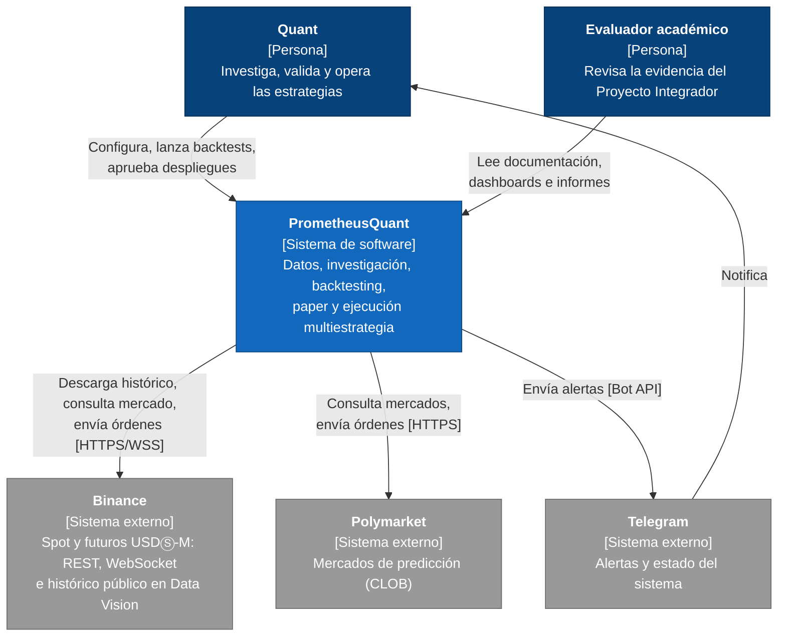
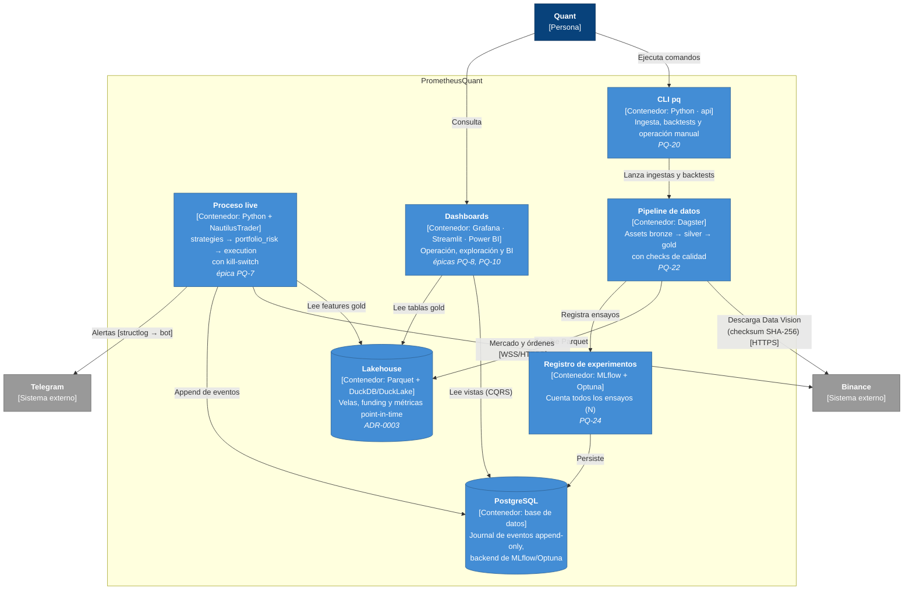

# Diagramas C4

Vistas del [modelo C4](https://c4model.com/) de Simon Brown. Los diagramas usan la notación de C4
dibujada con Mermaid para que se versionen como texto junto al código.

!!! note "Estado"
    Estos diagramas describen la **arquitectura objetivo** de la fase 0–1 de
    [`deploy/`](https://github.com/PrometheusQuant/prometheus-platform/tree/develop/deploy). Cada
    contenedor indica si ya existe o qué ticket lo construye.

## Nivel 1: contexto del sistema

Quién usa la plataforma y con qué sistemas externos habla.

## Nivel 2: contenedores

Las piezas que se despliegan por separado. El código de dominio y de aplicación es **uno solo**
(monolito modular, [ADR-0001](../adr/0001-monolito-modular-hexagonal.md)): el proceso live, el
pipeline y la CLI importan el mismo paquete `prometheus_platform` con distintos puntos de entrada.

## Correspondencia con los módulos (ADR-0001)

| Contenedor | Paquetes de `prometheus_platform` |
|---|---|
| CLI `pq` | `api` → `data_platform`, `research` |
| Proceso live | `strategies`, `portfolio_risk`, `execution`, `adapters` (Binance, paper) |
| Pipeline de datos | `data_platform`, `research`, `adapters` (Data Vision, persistencia) |
| Todos | `domain` (núcleo) y `ops` (configuración, logging, métricas) |

Las reglas de dependencia entre paquetes están en
[Estructura de directorios](estructura-de-directorios.md) y se verifican en CI con
`import-linter`.
