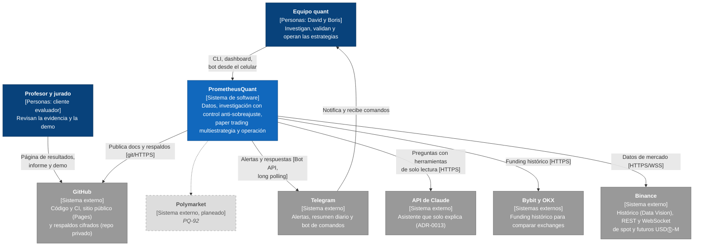
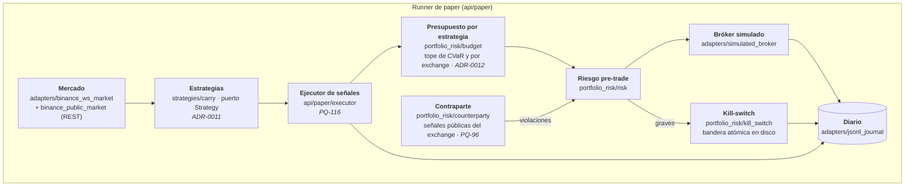
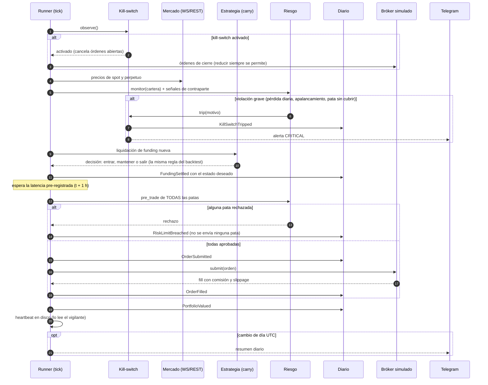
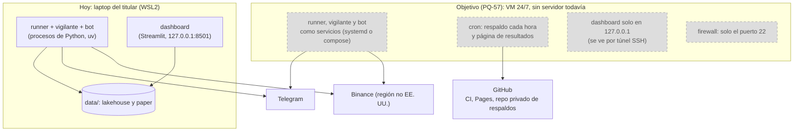

# Diagramas C4

Vistas del [modelo C4](https://c4model.com/) de Simon Brown, dibujadas con Mermaid para que se
versionen como texto junto al código.

!!! note "Estado al 22-nov-2026"
    Los diagramas describen el **sistema que existe hoy**. Lo que todavía no existe va en gris y
    punteado, con el ticket que lo construye. La primera versión (octubre) describía la arquitectura
    objetivo; las diferencias con lo construido se explican al final.

## Nivel 1: contexto del sistema

Quién usa la plataforma y con qué sistemas externos habla.

## Nivel 2: contenedores

Las piezas que corren por separado. El código es **uno solo** (monolito modular,
[ADR-0001](../adr/0001-monolito-modular-hexagonal.md)): todos los procesos importan el mismo
paquete `prometheus_platform` y se arrancan con la CLI `pq` (o `make`).

```mermaid
flowchart TB
    quant["<b>Equipo quant</b><br/>[Personas]"]

    subgraph pq["PrometheusQuant"]
        direction TB
        cli["<b>CLI pq</b><br/>[Python · api]<br/>Ingesta, research, informes,<br/>kill-switch y respaldos"]
        dagster["<b>Orquestador</b><br/>[Dagster]<br/>Assets bronze → silver → gold<br/>con checks · <i>ADR-0010</i>"]
        lake[("<b>Lakehouse</b><br/>[Parquet + DuckDB]<br/>Velas, funding y features point-in-time;<br/>gold en estrella para BI · <i>ADR-0003</i>")]
        registry[("<b>Registro de ensayos</b><br/>[JSONL en git + MLflow/SQLite]<br/>N global entre carriles · <i>PQ-112</i>")]
        runner["<b>Runner de paper</b><br/>[Python · pq paper run]<br/>Estrategias → presupuesto → riesgo<br/>→ bróker simulado, cada minuto"]
        journal[("<b>Diario de eventos</b><br/>[JSONL append-only + archivos de estado]<br/>Órdenes, fills, funding, valoraciones,<br/>kill-switch y heartbeat")]
        watchdog["<b>Vigilante</b><br/>[Python · pq paper watchdog]<br/>Alerta si el runner deja de reportar"]
        bot["<b>Bot de Telegram</b><br/>[Python · pq paper bot]<br/>/estado, /pnl, /kill y /pregunta"]
        dashboard["<b>Dashboard</b><br/>[Streamlit en Docker]<br/>Datos, research, operación<br/>y modo feria · <i>ADR-0009</i>"]
        reports["<b>Informes y página pública</b><br/>[Quarto, Typst y MkDocs]<br/>Informe final, póster y resultados"]
        backups["<b>Respaldos</b><br/>[age + git, cada hora]<br/>Estado del paper, cifrado"]
        powerbi["<b>Power BI</b><br/>[Desktop, en Windows]<br/>Dashboard de negocio sobre gold"]
        obs["<b>Observabilidad</b><br/>[Prometheus, Grafana, Loki]<br/><i>planeado: PQ-71, PQ-97</i>"]
    end

    binance["<b>Binance</b><br/>[Sistema externo]"]
    telegram["<b>Telegram</b><br/>[Sistema externo]"]
    github["<b>GitHub</b><br/>[Sistema externo]"]
    claude["<b>API de Claude</b><br/>[Sistema externo]"]

    quant -- "Comandos" --> cli
    quant -- "Consulta" --> dashboard
    quant -- "Celular" --> telegram
    cli -- "Lanza ingestas y research" --> lake
    dagster -- "Materializa assets" --> lake
    dagster -- "Data Vision (SHA-256)" --> binance
    cli -- "Cada ejecución" --> registry
    runner -- "Precios: WebSocket,<br/>respaldo REST" --> binance
    runner -- "Append de eventos" --> journal
    runner -- "Alertas ERROR/CRITICAL<br/>y resumen diario" --> telegram
    watchdog -- "Lee el heartbeat" --> journal
    watchdog -- "Alerta de caída" --> telegram
    bot -- "Lee el diario;<br/>/kill crea la bandera" --> journal
    bot -- "Long polling" --> telegram
    bot -- "/pregunta, solo lectura" --> claude
    dashboard -- "Solo lectura (:ro)" --> lake
    dashboard -- "Solo lectura (:ro)" --> journal
    reports -- "Lee artefactos" --> lake
    reports -- "Lee el diario" --> journal
    reports -- "Pages" --> github
    backups -- "Cifra" --> journal
    backups -- "Repo privado" --> github
    powerbi -- "Lee el export de gold" --> lake
    obs -.-> runner

    classDef person fill:#08427b,stroke:#052e56,color:#fff
    classDef container fill:#438dd5,stroke:#2e6295,color:#fff
    classDef external fill:#999,stroke:#6b6b6b,color:#fff
    classDef planned fill:#ddd,stroke:#999,color:#555,stroke-dasharray: 5 5
    class quant person
    class cli,dagster,lake,registry,runner,journal,watchdog,bot,dashboard,reports,backups,powerbi container
    class binance,telegram,github,claude external
    class obs planned
```

## Nivel 3: componentes del runner de paper

El runner es el contenedor que decide y opera. Cada flecha cruza un puerto de
[`domain/ports.py`](../arquitectura/estructura-de-directorios.md): los adaptadores se cambian sin tocar
el núcleo. Por ejemplo, el bróker simulado se reemplazará por Binance Demo en PQ-52.

## Flujo de una orden

Un ciclo del runner, de la señal a la alerta. Así es en el código (`api/paper/runner.py`).

**Por qué es seguro reiniciarlo:** el runner trabaja **por niveles**. El estado deseado queda en el
diario, y cada ciclo reconcilia las posiciones con él. Una caída entre dos patas se corrige en el
ciclo siguiente, y el kill-switch sobrevive a un reinicio porque es un archivo.

## Despliegue

**Dónde va a correr:**

- **Oracle Cloud Always Free:** VM A1 de 1 OCPU y 6 GB en `sa-bogota-1`. Se reintenta
  automáticamente hasta que Oracle tenga capacidad ([runbook](../runbooks/oracle-cloud.md)).
- **AWS:** cuenta en revisión, región São Paulo, como alternativa.

**Reglas para cualquier servidor:**

- ninguna región de EE. UU., porque Binance bloquea esas IP;
- solo el puerto 22 abierto;
- el servidor solo tiene la clave **pública** de los respaldos.

## Correspondencia con los módulos (ADR-0001)

| Contenedor | Paquetes de `prometheus_platform` |
|---|---|
| CLI `pq` | `api` → `data_platform`, `research`, `adapters` |
| Orquestador | `api/orquestacion` → `data_platform`, `adapters` (Data Vision, REST, bronze) |
| Runner de paper | `api/paper` → `strategies`, `execution`, `portfolio_risk`, `adapters` (mercado, bróker, diario) |
| Vigilante y bot | `api/paper` → `adapters` (diario, Telegram) |
| Dashboard | `api/dashboard` (solo lectura) |
| Informes y página pública | `api/report` → `research` y los artefactos |
| Todos | `domain` (núcleo y puertos) y `ops` (configuración, logging y alertas) |

Las reglas de dependencia entre paquetes están en
[Estructura de directorios](estructura-de-directorios.md) y se verifican en CI con
`import-linter`.

## Qué cambió respecto de la arquitectura objetivo de octubre

| Objetivo (octubre) | Lo construido | Por qué |
|---|---|---|
| PostgreSQL para el diario de eventos | JSONL append-only en disco | Un solo escritor y pocos KB al día: no justifica un servidor de base de datos. Se respalda cifrado cada hora |
| NautilusTrader en el proceso live | Runner propio con bróker simulado | Paridad exacta con el backtest y sin esperar las claves (PQ-17). ADR-0006 sigue en propuesta hasta el spike PQ-51 |
| MLflow con PostgreSQL | `mlflow-skinny` con SQLite y registro JSONL en git | N tiene que sumarse entre máquinas: el registro en git lo comparte (PQ-112) |
| Grafana para operar | Dashboard de Streamlit, alertas y bot de Telegram | Llegan al celular sin servidor; Grafana queda para PQ-71 |
