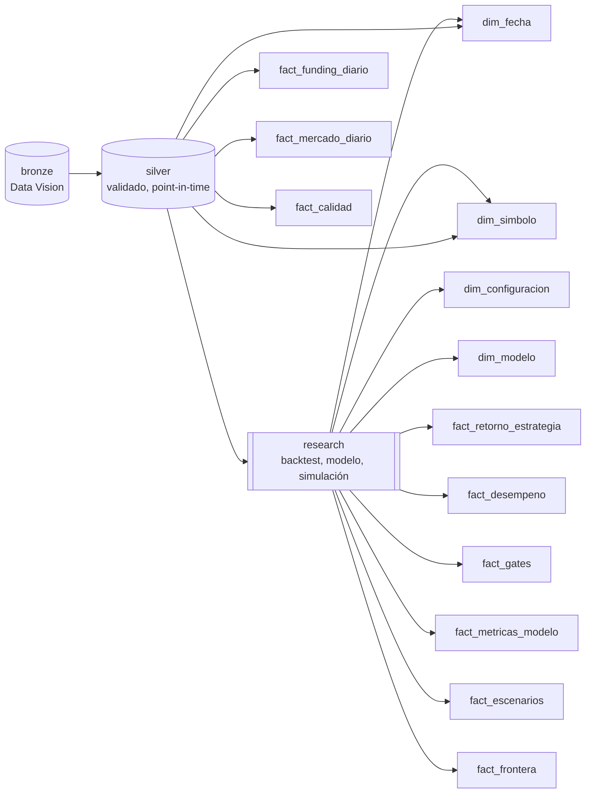
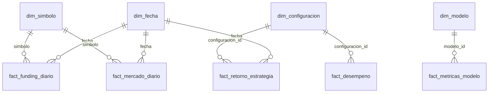

# Capa gold: modelo en estrella para BI

Capítulo 7.1 del Proyecto Integrador (PQ-46). La capa gold toma silver y los artefactos de research
y los organiza en **dimensiones** y **hechos** con claves de una sola columna, listos para Power BI
(PQ-47). Se reconstruye con un comando:

```bash
uv run pq gold build   # data/gold/*.parquet, gold.duckdb y export/*.csv
uv run pq gold docs    # regenera esta página desde las declaraciones del código
```

## Trazabilidad

Del dato crudo a la tabla de hechos. Bronze guarda el linaje de cada fila (`_source_file`,
`_source_sha256`); silver conserva `source_file`, y cada tabla gold declara sus fuentes.



## Modelo en estrella




Los hechos sin dimensión de fecha (`fact_gates`, `fact_escenarios`, `fact_frontera`,
`fact_calidad`, `fact_desempeno`, `fact_metricas_modelo`) son resultados agregados de una
evaluación, no series temporales.

## Garantías (se verifican en cada construcción)

- El esquema de cada tabla coincide con el declarado.
- Claves sin nulos ni duplicados; toda clave foránea existe en su dimensión.
- Ningún hecho con fecha tiene filas del holdout (desde el 2024-07-01).
- Lo que no existe en las fuentes queda nulo: no se rellena ni se inventa.

## Diccionario de datos de la capa gold

Generado por `uv run pq gold docs` desde `data_platform/gold.py`. No editar a mano.

Todos los hechos con fecha terminan el 2024-06-30: el holdout (desde el 2024-07-01) sigue
cerrado hasta su evaluación única (PQ-50).

### `dim_fecha` (dimensión)

Calendario continuo que cubre todas las fechas de los hechos.

- **Grano:** un día calendario UTC
- **Clave:** `fecha`
- **Origen:** `fechas de los hechos con fecha`

| Columna | Tipo | Descripción |
|---|---|---|
| `fecha` | Date | Día calendario UTC (clave) |
| `anio` | Int64 | Año |
| `trimestre` | Int64 | Trimestre (1-4) |
| `mes` | Int64 | Mes (1-12) |
| `nombre_mes` | String | Nombre del mes en español |
| `dia_semana` | String | Día de la semana en español |
| `periodo` | String | «desarrollo» antes del 2024-07-01; «holdout» desde esa fecha |

### `dim_simbolo` (dimensión)

Pares negociados y la hipótesis pre-registrada que los usa.

- **Grano:** un símbolo con datos en silver
- **Clave:** `simbolo`
- **Origen:** `silver/funding/<SYMBOL>.parquet`; `research/carry/H*/summary.json (symbols)`

| Columna | Tipo | Descripción |
|---|---|---|
| `simbolo` | String | Par en Binance, p. ej. SOLUSDT (clave) |
| `activo_base` | String | Activo base, p. ej. SOL |
| `activo_cotizado` | String | Activo de cotización, p. ej. USDT |
| `hipotesis` | String | Hipótesis del carry que lo incluye (H1, H2) o nulo |

### `dim_configuracion` (dimensión)

Grid pre-registrado del carry (k x θ) y el benchmark B1 de cada hipótesis.

- **Grano:** una configuración evaluada de una hipótesis
- **Clave:** `configuracion_id`
- **Origen:** `research/carry/H*/summary.json`; `research/carry/H*/daily_returns.parquet`

| Columna | Tipo | Descripción |
|---|---|---|
| `configuracion_id` | String | Hipótesis/configuración, p. ej. H2/k9-theta20 (clave) |
| `hipotesis` | String | H1 (BTC, ETH) o H2 (SOL, BNB, XRP) |
| `configuracion` | String | Nombre de la configuración, p. ej. k9-theta20 o B1-siempre-activo |
| `ventana_k` | Int64 | Liquidaciones promediadas en la señal (k); nulo en B1 |
| `umbral_theta` | Float64 | Umbral de entrada anualizado (θ); nulo en B1 |
| `es_seleccionada` | Boolean | La configuración que eligió la CPCV |
| `es_benchmark` | Boolean | Benchmark B1: carry siempre activo |
| `sharpe_cpcv` | Float64 | Sharpe medio de test en la CPCV; nulo en B1 |

### `dim_modelo` (dimensión)

Modelos del funding: regresión del nivel/residuo y clasificación del régimen.

- **Grano:** un modelo evaluado en el capítulo 5
- **Clave:** `modelo_id`
- **Origen:** `research/funding_model/<formulación>/summary.json`

| Columna | Tipo | Descripción |
|---|---|---|
| `modelo_id` | String | Tarea/algoritmo/ajuste, p. ej. clasificacion/random_forest/ajustado |
| `tarea` | String | regresion o clasificacion |
| `algoritmo` | String | Nombre del algoritmo |
| `ajustado` | Boolean | Si se ajustaron hiperparámetros con GridSearch |
| `formulacion` | String | residual o level: qué se predice |

### `fact_funding_diario` (hecho)

Funding cobrado o pagado por las posiciones cortas en el perpetuo, por día.

- **Grano:** un símbolo x un día UTC (solo desarrollo)
- **Clave:** `fecha`, `simbolo`
- **Claves foráneas:** `fecha` → `dim_fecha`, `simbolo` → `dim_simbolo`
- **Origen:** `silver/funding/<SYMBOL>.parquet ← bronze/dataset=fundingRate`

| Columna | Tipo | Descripción |
|---|---|---|
| `fecha` | Date | Día UTC de la liquidación (event_time) |
| `simbolo` | String | Par |
| `funding_total` | Float64 | Suma de las tasas liquidadas en el día (fracción del nocional) |
| `funding_medio` | Float64 | Tasa media por liquidación |
| `funding_anualizado_medio` | Float64 | Tasa anualizada media (según el intervalo de cada fila) |
| `liquidaciones` | Int64 | Número de liquidaciones en el día |

### `fact_mercado_diario` (hecho)

Cierre diario de spot y perpetuo, base y volumen negociado.

- **Grano:** un símbolo x un día UTC (solo desarrollo)
- **Clave:** `fecha`, `simbolo`
- **Claves foráneas:** `fecha` → `dim_fecha`, `simbolo` → `dim_simbolo`
- **Origen:** `silver/klines/market=spot/interval=1h/<SYMBOL>.parquet ← bronze/dataset=klines`; `silver/klines/market=um/interval=1h/<SYMBOL>.parquet ← bronze/dataset=klines`

| Columna | Tipo | Descripción |
|---|---|---|
| `fecha` | Date | Día UTC (open_time de las velas horarias) |
| `simbolo` | String | Par |
| `cierre_spot` | Float64 | Último cierre horario del día en spot |
| `cierre_perp` | Float64 | Último cierre horario del día en el perpetuo USDⓈ-M |
| `base` | Float64 | (cierre_perp - cierre_spot) / cierre_spot |
| `volumen_spot_usd` | Float64 | Volumen en USDT negociado en spot en el día |
| `volumen_perp_usd` | Float64 | Volumen en USDT negociado en el perpetuo en el día |

### `fact_retorno_estrategia` (hecho)

Retorno diario de cartera de cada configuración del grid, neto de costes.

- **Grano:** una configuración x un día UTC (solo desarrollo)
- **Clave:** `fecha`, `configuracion_id`
- **Claves foráneas:** `fecha` → `dim_fecha`, `configuracion_id` → `dim_configuracion`
- **Origen:** `research/carry/H*/daily_returns.parquet ← silver (funding y klines)`

| Columna | Tipo | Descripción |
|---|---|---|
| `fecha` | Date | Día UTC al que corresponde el retorno (valoración a las 00:00 del siguiente) |
| `configuracion_id` | String | Configuración |
| `retorno` | Float64 | Retorno diario neto de costes |
| `capital` | Float64 | Capital acumulado partiendo de 1 |

### `fact_desempeno` (hecho)

Métricas del periodo de desarrollo de la configuración elegida y del benchmark.

- **Grano:** una configuración con métricas completas (seleccionada y B1)
- **Clave:** `configuracion_id`
- **Claves foráneas:** `configuracion_id` → `dim_configuracion`
- **Origen:** `research/carry/H*/summary.json (selected_performance, benchmark_B1)`

| Columna | Tipo | Descripción |
|---|---|---|
| `configuracion_id` | String | Configuración |
| `sharpe` | Float64 | Sharpe anualizado |
| `cagr` | Float64 | Crecimiento anual compuesto |
| `max_drawdown` | Float64 | Máxima caída desde un pico (negativa) |
| `calmar` | Float64 | CAGR / |máximo drawdown| |
| `t_stat` | Float64 | Estadístico t del retorno medio |
| `dias` | Int64 | Días evaluados |

### `fact_gates` (hecho)

Gates anti-sobreajuste del pre-registro (G1-G4) y su resultado.

- **Grano:** un gate x una hipótesis
- **Clave:** `gate_id`
- **Origen:** `research/carry/H*/summary.json (gates)`

| Columna | Tipo | Descripción |
|---|---|---|
| `gate_id` | String | Hipótesis/gate, p. ej. H2/G1 (clave) |
| `hipotesis` | String | Hipótesis |
| `gate` | String | G1 a G4 |
| `criterio` | String | Criterio pre-registrado |
| `valor` | Float64 | Valor obtenido |
| `pasa` | Boolean | Si cumple el criterio |

### `fact_metricas_modelo` (hecho)

Métricas de validación walk-forward; las que no aplican a la tarea quedan nulas.

- **Grano:** un modelo
- **Clave:** `modelo_id`
- **Claves foráneas:** `modelo_id` → `dim_modelo`
- **Origen:** `research/funding_model/<formulación>/summary.json`

| Columna | Tipo | Descripción |
|---|---|---|
| `modelo_id` | String | Modelo |
| `rmse` | Float64 | Raíz del error cuadrático medio (regresión) |
| `mae` | Float64 | Error absoluto medio (regresión) |
| `r2` | Float64 | Coeficiente de determinación (regresión) |
| `auc` | Float64 | Área bajo la curva ROC (clasificación) |
| `f1` | Float64 | F1 de la clase de funding alto (clasificación) |

### `fact_escenarios` (hecho)

Distribución del retorno anual simulado del carry según el riesgo del exchange.

- **Grano:** un escenario del Monte Carlo
- **Clave:** `escenario`
- **Origen:** `research/simulation/summary.json (escenarios)`

| Columna | Tipo | Descripción |
|---|---|---|
| `escenario` | String | Escenario de quiebra del exchange (clave) |
| `media` | Float64 | Retorno anual medio |
| `mediana` | Float64 | Retorno anual mediano |
| `p5` | Float64 | Percentil 5 |
| `p95` | Float64 | Percentil 95 |
| `var95` | Float64 | VaR al 95 % (pérdida positiva) |
| `cvar95` | Float64 | CVaR al 95 % (pérdida positiva) |
| `prob_bajo_hurdle` | Float64 | Probabilidad de rendir menos que la stablecoin al 4 % |
| `prob_perdida` | Float64 | Probabilidad de perder dinero en el año |
| `tiempo_invertido` | Float64 | Fracción del tiempo con posición abierta |
| `ciclos` | Float64 | Ciclos de entrada y salida por año |

### `fact_frontera` (hecho)

Optimización con CVaR: retorno esperado y riesgo según el peso en el carry.

- **Grano:** un peso del carry en la cartera
- **Clave:** `peso_carry`
- **Origen:** `research/simulation/summary.json (frontera)`

| Columna | Tipo | Descripción |
|---|---|---|
| `peso_carry` | Float64 | Fracción del capital en el carry (el resto, en la stablecoin al 4 %) |
| `retorno_esperado` | Float64 | Retorno anual esperado de la cartera |
| `cvar95` | Float64 | CVaR al 95 % de la cartera |
| `cumple` | Boolean | Si respeta el límite de CVaR |

### `fact_calidad` (hecho)

Informe de calidad de cada tabla silver: filas, huecos y outliers.

- **Grano:** una tabla silver
- **Clave:** `tabla`
- **Origen:** `silver/_quality/*.json`

| Columna | Tipo | Descripción |
|---|---|---|
| `tabla` | String | Tabla silver, p. ej. funding/SOLUSDT (clave) |
| `filas` | Int64 | Filas |
| `duplicados_eliminados` | Int64 | Duplicados idénticos eliminados |
| `huecos` | Int64 | Huecos detectados (no se imputan) |
| `periodos_faltantes` | Int64 | Periodos que faltan dentro de los huecos |
| `hueco_mayor_horas` | Float64 | Duración del hueco más largo |
| `outliers` | Int64 | Valores marcados como outlier (no se eliminan) |
| `desde` | String | Primer registro (UTC) |
| `hasta` | String | Último registro (UTC) |
