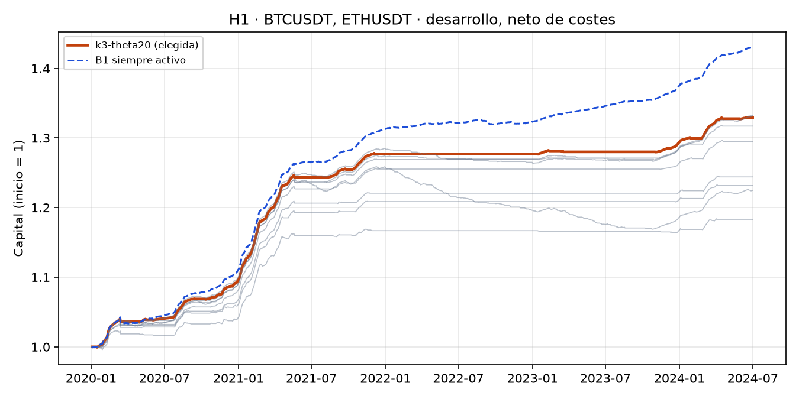
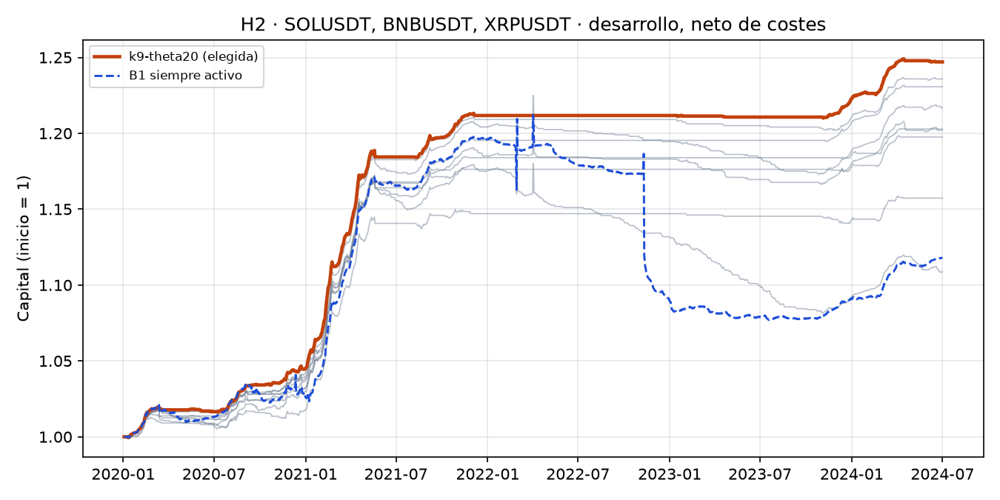

# Estrategia 1 · Carry de funding: evaluación en el periodo de desarrollo

- **Tickets:** PQ-23 (backtest), PQ-24 (registro de experimentos), PQ-25 (validación)
- **Fecha de ejecución:** 2026-10-30, **una sola ejecución por hipótesis**, con el código del commit `e4cd835`
- **Periodo:** desarrollo, del 2020-01-03 al 2024-07-01 (1.642 días). **El holdout no se abrió.**
- **Protocolo:** [pre-registro](pre-registro.md), con la enmienda 1 (fijada antes del primer
  backtest) y la enmienda 2 (corrección del apalancamiento 1x, declarada antes de esta evaluación)
- **Reproducir:** `pq silver build --symbol <S>` para los 5 símbolos y luego
  `pq research carry --hypothesis H1` y `--hypothesis H2`. Los ensayos quedan en MLflow
  (`data/mlflow/mlflow.db`; se ven con `uvx mlflow ui --backend-store-uri sqlite:///data/mlflow/mlflow.db`).

## Resumen

| Hipótesis | Configuración elegida (CPCV) | Sharpe neto | CAGR neto | Gates | Decisión |
|---|---|---|---|---|---|
| **H1** BTC + ETH | k = 3, θ = 20 % | 7,69 | 6,52 % | G1 ✅ G2 ✅ G3 ✅ **G4 ❌** | **Se descarta**: el timing no bate al carry siempre activo |
| **H2** SOL + BNB + XRP | k = 9, θ = 20 % | 5,57 | 5,03 % | G1 ✅ G2 ✅ G3 ✅ G4 ✅ | **Pasa a holdout**, que se abre solo cuando PQ-17 verifique las comisiones |

**Lectura honesta.** Un Sharpe de 5 a 9 **no** significa una máquina de dinero. Un carry
delta-neutral cobra funding casi todos los días y cubre el precio, así que sus retornos diarios
son muy estables. El riesgo real está en eventos que el backtest no contiene: quiebra del exchange,
autodesapalancamiento (ADL), liquidaciones y depeg de la stablecoin (pre-registro §9). Eso es lo
que advierte el BIS: el carry es una prima por riesgo de cola. La métrica que importa para decidir
es el **CAGR frente al 4 % de una stablecoin**: H2 lo supera por solo **1 punto**.

### H1 · BTCUSDT, ETHUSDT

| Métrica | Elegida (k3-theta20) | B1 siempre activo |
|---|---|---|
| Sharpe anualizado (neto) | **7,69** | 9,18 |
| CAGR neto | 6,52 % | 8,28 % |
| Drawdown máximo | -0,51 % | -0,87 % |
| Calmar | 12,7 | 9,5 |
| t-estadístico | 16,3 | 19,5 |
| Asimetría / curtosis (diarias) | 1,82 / 19,5 | -0,26 / 48,4 |

| Gate | Criterio | Valor | Resultado |
|---|---|---|---|
| G1 | Deflated Sharpe > 0.95 (N = 20) | 1,0000 | ✅ pasa |
| G2 | PBO < 0.5 | 0,1486 | ✅ pasa |
| G3 | t > 3.0 | 16,3182 | ✅ pasa |
| G4 | Sharpe > B1 (9.18) y CAGR > 4% | 7,6937 | ❌ no pasa |

**Descomposición del P&L** (capital inicial = 1): funding 0,361, precio y basis 0,005, costes -0,037; 25 ciclos de entrada/salida; invertido el 37,88 % del tiempo.

**Sensibilidad (solo informativa):** con costes maker y BNB, Sharpe 8,26; con un 4 % anual sobre el efectivo ocioso, Sharpe 10,72.

**Sharpe medio de prueba en CPCV (15 particiones)**

| Configuración | Sharpe CPCV |
|---|---|
| k3-theta20 ← elegida | 7,84 |
| k9-theta20 | 7,70 |
| k21-theta10 | 7,30 |
| k9-theta10 | 7,20 |
| k21-theta20 | 6,76 |
| k21-theta30 | 5,87 |
| k9-theta30 | 5,50 |
| k3-theta30 | 3,94 |
| k3-theta10 | 3,91 |

### H2 · SOLUSDT, BNBUSDT, XRPUSDT

| Métrica | Elegida (k9-theta20) | B1 siempre activo |
|---|---|---|
| Sharpe anualizado (neto) | **5,57** | 0,66 |
| CAGR neto | 5,03 % | 2,51 % |
| Drawdown máximo | -0,39 % | -11,16 % |
| Calmar | 12,8 | 0,2 |
| t-estadístico | 11,8 | 1,4 |
| Asimetría / curtosis (diarias) | 2,90 / 24,2 | -8,79 / 466,3 |

| Gate | Criterio | Valor | Resultado |
|---|---|---|---|
| G1 | Deflated Sharpe > 0.95 (N = 20) | 1,0000 | ✅ pasa |
| G2 | PBO < 0.5 | 0,0449 | ✅ pasa |
| G3 | t > 3.0 | 11,8198 | ✅ pasa |
| G4 | Sharpe > B1 (0.66) y CAGR > 4% | 5,5728 | ✅ pasa |

**Descomposición del P&L** (capital inicial = 1): funding 0,314, precio y basis 0,011, costes -0,079; 69 ciclos de entrada/salida; invertido el 27,19 % del tiempo.

**Sensibilidad (solo informativa):** con costes maker y BNB, Sharpe 6,75; con un 4 % anual sobre el efectivo ocioso, Sharpe 8,88.

**Sharpe medio de prueba en CPCV (15 particiones)**

| Configuración | Sharpe CPCV |
|---|---|
| k9-theta20 ← elegida | 5,77 |
| k21-theta20 | 5,52 |
| k21-theta30 | 5,04 |
| k3-theta20 | 4,99 |
| k9-theta30 | 4,42 |
| k9-theta10 | 3,16 |
| k3-theta30 | 2,90 |
| k21-theta10 | 2,76 |
| k3-theta10 | 1,15 |

## Figuras

En gris, las 9 configuraciones; en naranja, la elegida por CPCV; en azul discontinuo, B1. En 2022
(mercado bajista, funding bajo o negativo) la estrategia se queda fuera mientras B1 sigue cobrando
el funding base. Por eso B1 termina por encima en BTC y ETH.

En las altcoins, B1 sufre: paga funding negativo y aguanta la basis en los episodios de estrés
(drawdown de −11 %), y ahí el filtro por umbral sí aporta.

## Integridad del proceso

- **Ensayos (N = 20):** 9 configuraciones por hipótesis registradas en MLflow por Optuna
  `GridSampler`, más las 2 ejecuciones de la prueba de humo declaradas en la enmienda 2.
- **Prueba de humo:** detectó un error real (el apalancamiento crecía con el precio hasta ~4x). Se
  corrigió antes de la evaluación y se declaró en la enmienda 2.
- **Holdout:** cerrado. El código de evaluación corta todas las simulaciones en `HOLDOUT_START`
  (2024-07-01), y `development_only` anula el objetivo del modelo cuya siguiente liquidación cae en
  el holdout. Por la enmienda 1.11, el holdout de H2 no se abre hasta que PQ-17 verifique las
  comisiones desde la cuenta.
- **Lo que no se modela:** costes de financiación del margen, cambios de nivel VIP, latencia real
  de ejecución, ADL y liquidaciones (pre-registro §9).

## Próximo paso

Ver [decision.md](decision.md).
