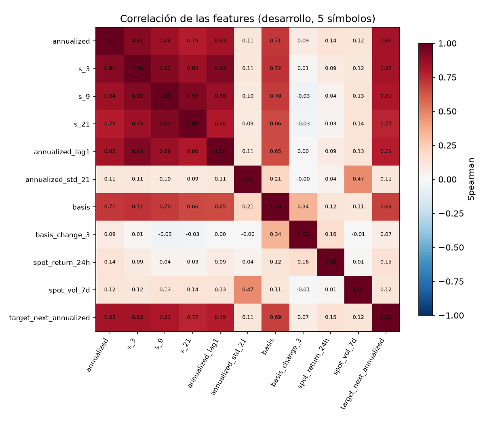

# Análisis exploratorio de las features del funding

- **Tickets:** PQ-31 (feature engineering, cap. 4.3) · **Fecha:** 2026-10-30
- **Datos:** panel *point-in-time* por liquidación de funding de BTC, ETH, SOL, BNB y XRP, **solo periodo de desarrollo** (hasta 2024-06-30): 23.813 liquidaciones.
- **Reproducir:** `pq research eda --figures docs/investigacion/img`

## Variables

| Variable | Definición | Por qué |
|---|---|---|
| `annualized` | Tasa liquidada × 8760 / intervalo (h) | Hallazgo 3 de la auditoría: el intervalo varía |
| `s_3`, `s_9`, `s_21` | Media de las últimas k tasas anualizadas | Señal del pre-registro |
| `annualized_lag1` | Tasa anterior | Persistencia |
| `annualized_std_21` | Desviación de las últimas 21 tasas | Régimen de volatilidad del funding |
| `basis` | perp / spot − 1 al cierre de la vela que termina en t | El funding se calcula con el premium index |
| `basis_change_3` | Cambio de la basis en 3 liquidaciones | Dinámica de la prima |
| `spot_return_24h`, `spot_vol_7d` | Retorno 24 h y volatilidad anualizada 7 días | Demanda de apalancamiento (BIS WP 1087) |
| `target_next_annualized` | Tasa de la **siguiente** liquidación | Objetivo del modelo (PQ-32); nunca es una feature |

Todas usan solo velas con `knowledge_time ≤ t` (join *as-of*, test en `tests/unit/research/test_panel.py`).

## Estadística descriptiva

| Variable | n | Media | Desv. | Mín. | P25 | Mediana | P75 | Máx. |
|---|---|---|---|---|---|---|---|---|
| `annualized` | 23.813 | 0,0721 | 1,6970 | -87,6000 | 0,0000 | 0,1095 | 0,1095 | 5,3424 |
| `s_3` | 23.803 | 0,0719 | 1,5916 | -87,6000 | 0,0000 | 0,1012 | 0,1156 | 3,5202 |
| `s_9` | 23.773 | 0,0715 | 1,4402 | -73,6956 | 0,0055 | 0,0885 | 0,1411 | 2,6415 |
| `s_21` | 23.713 | 0,0710 | 1,2078 | -42,5090 | 0,0083 | 0,0812 | 0,1586 | 2,3006 |
| `annualized_lag1` | 23.808 | 0,0721 | 1,6972 | -87,6000 | 0,0000 | 0,1095 | 0,1095 | 5,3424 |
| `annualized_std_21` | 23.713 | 0,2353 | 1,2027 | 0,0000 | 0,0426 | 0,0876 | 0,2141 | 37,2026 |
| `basis` | 23.758 | -0,0001 | 0,0024 | -0,1973 | -0,0005 | -0,0002 | 0,0005 | 0,0086 |
| `basis_change_3` | 23.712 | 0,0000 | 0,0025 | -0,1965 | -0,0003 | 0,0000 | 0,0003 | 0,1285 |
| `spot_return_24h` | 23.767 | 0,0028 | 0,0507 | -0,4460 | -0,0184 | 0,0009 | 0,0219 | 0,7310 |
| `spot_vol_7d` | 23.799 | 0,8374 | 0,5384 | 0,1398 | 0,5056 | 0,6974 | 0,9904 | 4,2226 |
| `target_next_annualized` | 23.808 | 0,0721 | 1,6972 | -87,6000 | 0,0000 | 0,1095 | 0,1095 | 5,3424 |

**Lectura**

- La **mediana del funding anualizado es exactamente 10,95 %**: la tasa base del contrato (0,01 %/8 h). Más de la mitad de las liquidaciones están en ese valor.
- Colas extremas: el mínimo (−8.760 % anualizado) es SOL durante la caída de FTX (−2 % por liquidación cada 2 h). Por eso las correlaciones son de **Spearman** y los modelos de PQ-32 incluyen árboles, robustos a estas colas.
- La basis media es casi cero (−0,007 %), pero su desviación (0,24 %) es del mismo orden que el coste de ida y vuelta del carry.

## Correlaciones con el objetivo

| Feature | ρ con la próxima tasa |
|---|---|
| `annualized` | +0,834 |
| `s_3` | +0,834 |
| `s_9` | +0,805 |
| `s_21` | +0,766 |
| `annualized_lag1` | +0,788 |
| `annualized_std_21` | +0,114 |
| `basis` | +0,685 |
| `basis_change_3` | +0,071 |
| `spot_return_24h` | +0,148 |
| `spot_vol_7d` | +0,124 |

**Lectura:** el funding es muy **persistente**: la tasa actual explica la mayor parte de la siguiente (ρ = 0,83). La basis aporta información propia (ρ = 0,69), coherente con la fórmula del funding. Las variables de precio y volatilidad aportan poco. Es una hipótesis para el modelo: superar al baseline de persistencia será difícil.
