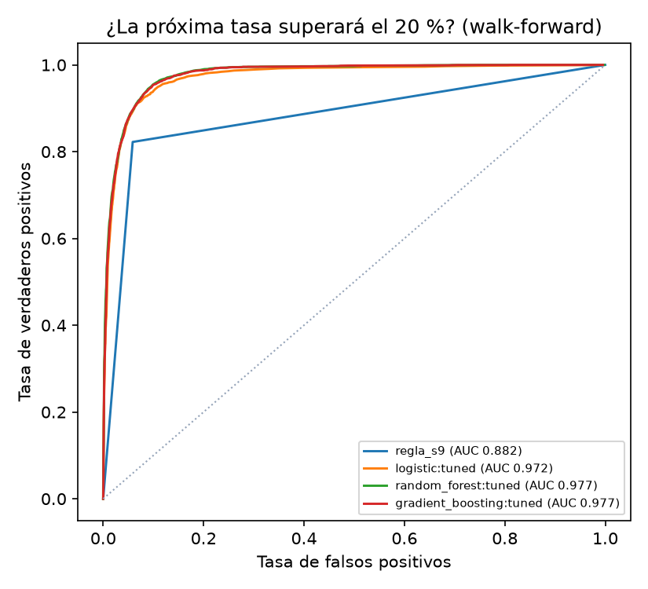

# Modelo predictivo del funding (capítulo 5)

- **Ticket:** PQ-32 · **Fecha:** 2026-10-30
- **Pregunta:** ¿un modelo de ML predice el funding de la **próxima** liquidación mejor que los baselines ingenuos?
- **Datos:** panel *point-in-time* de BTC, ETH, SOL, BNB y XRP, **solo periodo de desarrollo**: 23,628 liquidaciones. El holdout del pre-registro no se usa.
- **Reproducir:** `pq research funding-model --figures docs/investigacion/img --target-mode residual`. Los ensayos quedan en MLflow, experimento `funding-model`.

## 5.1 Selección de algoritmos

| Algoritmo | Tipo | Por qué |
|---|---|---|
| Persistencia (tasa actual) | Baseline | El EDA mostró ρ = 0,83 entre tasas consecutivas: es el rival a batir |
| Media `S_9` | Baseline | La señal del pre-registro del carry |
| Ridge | Lineal regularizado | Lineal regularizado: interpretable, difícil de sobreajustar; captura la persistencia. |
| Random Forest | Ensamble de árboles | No lineal y robusto a colas pesadas. |
| Gradient Boosting (`HistGradientBoosting`) | Boosting | Estado del arte en datos tabulares. |
| Regresión logística | Clasificación lineal | Baseline probabilístico lineal y calibrado. |

No se usan redes neuronales: con unos 24.000 ejemplos tabulares y una GPU de 4 GB, los árboles son el estado del arte en este tipo de datos y son más fáciles de auditar.

## 5.2 Entrenamiento y validación

- **Walk-forward temporal** (`TimeSeriesSplit`, 5 pliegues, hueco de 15 filas): siempre se entrena con el pasado y se evalúa con el futuro. Nunca hay mezcla aleatoria, que en series temporales filtraría información.
- **GridSearch anidado:** en cada pliegue, los hiperparámetros se eligen con validación temporal **dentro** del entrenamiento.
- **Colas pesadas:** las features y el objetivo de entrenamiento se winsorizan al 1–99 % con los cuantiles del pliegue de entrenamiento (sin fuga). Las métricas se calculan sobre el valor real.
- **Semilla fija** (42) y registro de cada ensayo en MLflow.

### Dos formulaciones, un error encontrado y corregido

| Versión | Qué predice | Resultado |
|---|---|---|
| v1 (`level`) | La tasa siguiente directamente | Los modelos **pierden** contra la persistencia (R² ≈ 0,07 frente a 0,71): al winsorizar no pueden reproducir las colas (SOL en la caída de FTX), y esas colas dominan el RMSE |
| v2 (`residual`) | El **cambio** sobre la persistencia; luego se suma la tasa actual | Los modelos **superan** a la persistencia (tabla siguiente) |

Una primera ejecución de la v2 tenía un error: los modelos *por defecto* no sumaban la tasa actual al residuo. Se detectó al ver que Ridge α = 1 y α = 10 daban resultados muy distintos, cuando el diagnóstico por pliegue mostraba que eran casi iguales. Se corrigió, se añadió un test de regresión y se repitió. Las tres ejecuciones (v1, v2 con el error y v2 corregida) quedan registradas en MLflow: 45 ensayos en total.

## 5.3 Resultados

### Regresión: tasa anualizada de la próxima liquidación (v2)

| Modelo | Ajuste | RMSE | MAE | R² fuera de muestra | Hiperparámetros (último pliegue) |
|---|---|---|---|---|---|
| random_forest | por defecto | 0,9971 | 0,1497 | 0,710 | — |
| ridge | por defecto | 0,9973 | 0,1484 | 0,710 | — |
| ridge | GridSearch | 0,9973 | 0,1483 | 0,710 | alpha=10.0 |
| random_forest | GridSearch | 0,9981 | 0,1450 | 0,709 | max_depth=8, min_samples_leaf=20 |
| gradient_boosting | GridSearch | 0,9985 | 0,1453 | 0,709 | l2_regularization=1.0, learning_rate=0.1, max_depth=3 |
| gradient_boosting | por defecto | 0,9989 | 0,1479 | 0,709 | — |
| persistencia | — | 1,0043 | 0,1483 | 0,706 | — |
| media_s9 | — | 1,4129 | 0,1869 | 0,417 | — |

**Test de Diebold-Mariano** (pérdida cuadrática) del mejor modelo frente a la persistencia: DM = -2,02, p = 0,043. La mejora es **estadísticamente significativa al 5 %, pero pequeña**: el RMSE baja ≈ 0,7 % y el MAE del Random Forest ajustado baja un 2,2 %. Para referencia, en la v1 el mejor modelo perdía contra la persistencia (DM = 2,27, p = 0,023).

### Clasificación: ¿la próxima tasa superará θ = 20 %?

| Modelo | Ajuste | ROC-AUC | F1 | Falsos positivos | Falsos negativos |
|---|---|---|---|---|---|
| random_forest | GridSearch | 0,977 | 0,813 | 505 | 646 |
| gradient_boosting | GridSearch | 0,977 | 0,813 | 468 | 673 |
| random_forest | por defecto | 0,974 | 0,802 | 532 | 685 |
| gradient_boosting | por defecto | 0,973 | 0,805 | 557 | 651 |
| logistic | GridSearch | 0,972 | 0,753 | 268 | 1085 |
| logistic | por defecto | 0,972 | 0,760 | 279 | 1045 |
| regla_s9 | regla | 0,882 | 0,772 | 972 | 559 |

**Lectura:** esta es la pregunta útil para operar. El Random Forest ajustado sube el ROC-AUC de 0,882 (regla `S_9 ≥ 20 %`) a **0,977** y reduce los **falsos positivos de 972 a 505**, es decir, menos entradas en momentos en que el funding no compensa. Los falsos negativos suben ligeramente (559 → 646).

### Antes y después del ajuste de hiperparámetros

- **Regresión:** el ajuste casi no cambia el RMSE (≤ 0,0015). Lo que mejora el resultado es la **formulación** (v1 → v2), no los hiperparámetros.
- **Clasificación:** el ajuste sube el AUC del Random Forest de 0,974 a 0,978 y el F1 de 0,802 a 0,813.

## Conclusión y siguiente paso

1. El funding es casi un paseo persistente alrededor de la tasa base del contrato: un modelo de ML solo añade una mejora pequeña, aunque significativa, al predecir su valor.
2. Para **decidir cuándo entrar** al carry, un clasificador sí mejora con claridad a la regla del pre-registro.
3. **No se usa todavía en la estrategia.** Cambiar la señal del carry por el clasificador es una **hipótesis nueva (H3)**, que necesita su propio pre-registro con el número de ensayos de este estudio (Sprint 3, épica PQ-12).
