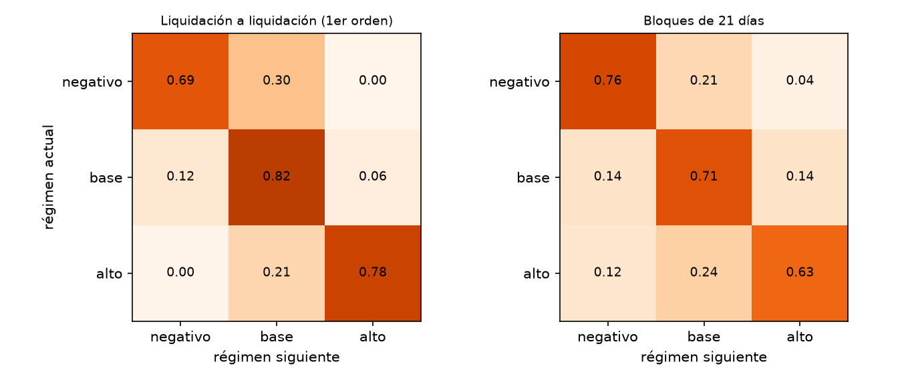
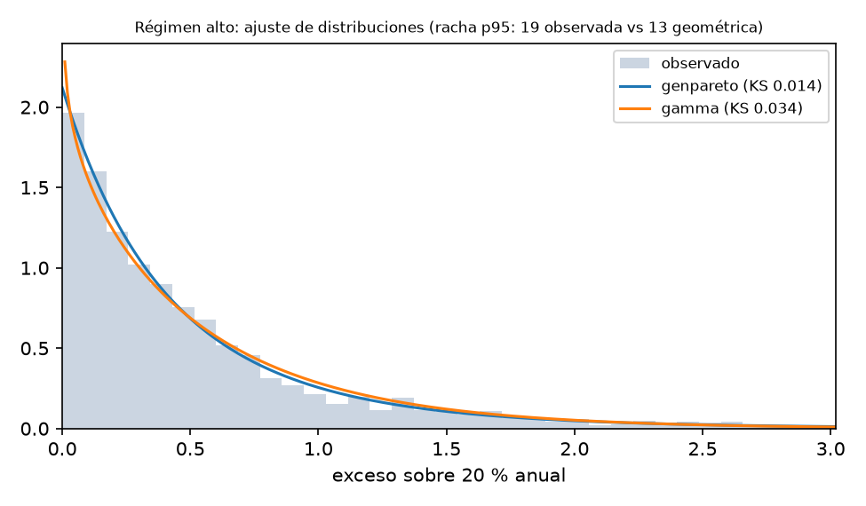
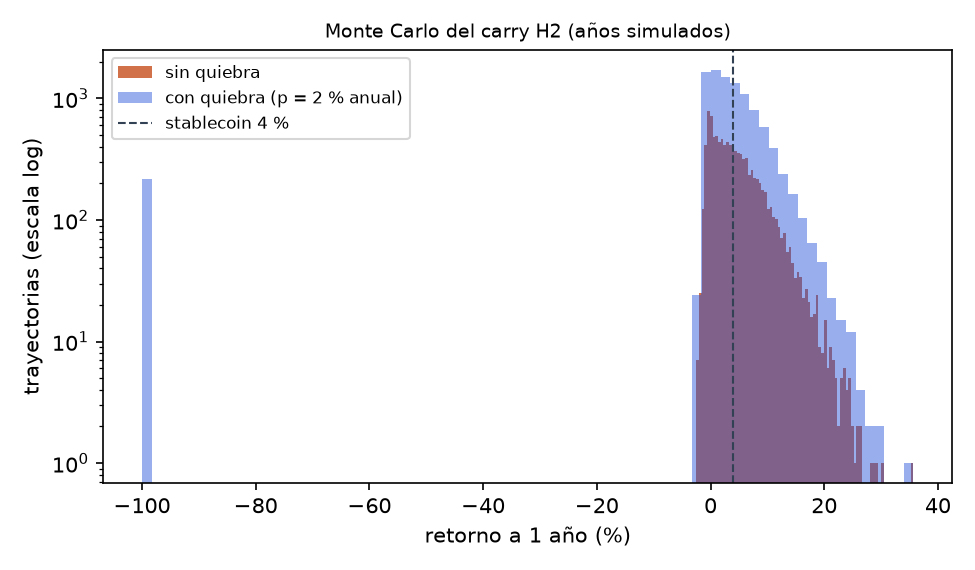

# Simulación y optimización del carry (capítulo 6)

- **Ticket:** PQ-33 · **Fecha:** 2026-11-05
- **Estrategia simulada:** H2 del carry (SOL, BNB, XRP; k = 9, θ = 20 %), la que pasó los cuatro gates en desarrollo
- **Datos:** periodo de desarrollo (hasta 2024-06-30). El holdout sigue cerrado.
- **Reproducir:** `pq research simulate --figures docs/investigacion/img` (semilla 42, 10.000 años simulados)

## Por qué simular

El backtest muestra **un solo camino**: el que ocurrió. Para decidir cuánto capital arriesgar
necesitamos la **distribución** de resultados posibles y los escenarios que la historia no contiene,
como la quiebra del exchange.

## 6.1 Generación de pseudoaleatorios y bondad de ajuste

### Regímenes del funding y cadena de Markov

Cada liquidación se clasifica en un régimen: **negativo** (< 0), **base** (0–20 % anual) o **alto**
(≥ 20 %, el umbral de entrada de H2). La matriz de transición se **cuenta en los datos**: no se supone
(OmniVoC, el proyecto anterior, usaba una matriz escrita a mano).

| actual \ siguiente | negativo | base | alto |
|---|---|---|---|
| negativo | 0,69 | 0,30 | 0,00 |
| base | 0,12 | 0,82 | 0,06 |
| alto | 0,00 | 0,21 | 0,78 |

- Probabilidades estacionarias: negativo 23,0 %, base 59,7 %, alto 17,2 %.
- **Prueba χ² de independencia** (H0: el régimen siguiente no depende del actual): χ² = 12078, p ≈ 0e+00. **Se rechaza**: el funding tiene memoria.

### ¿Las rachas son geométricas, como supone una Markov de primer orden?

Una cadena de Markov de primer orden obliga a que la duración de cada racha sea geométrica (sin memoria).
Se compara con las rachas reales:

| Régimen | Rachas | Duración media | p95 observado | p95 geométrica | p-valor χ² |
|---|---|---|---|---|---|
| negativo | 981 | 3,3 | 13 | 9 | 1.0e-50 |
| base | 1488 | 5,6 | 22 | 16 | 3.3e-110 |
| alto | 525 | 4,6 | 19 | 13 | 3.3e-43 |

**Se rechaza en los tres regímenes**: las rachas reales tienen colas más largas (p95 de 19 liquidaciones en
el régimen alto, frente a 13 en la geométrica). Esto anticipa que una Markov de primer orden no basta (ver 6.2).

### Distribución de la tasa dentro de cada régimen

En el régimen base hay **dos masas puntuales**: la tasa del contrato (10,95 %) y el funding exactamente
cero. Se modelan aparte, y el resto se ajusta a distribuciones candidatas. Se elige la de menor KS.

| Régimen | n | Masas puntuales | Distribución | KS (D) | KS p | χ² p |
|---|---|---|---|---|---|---|
| negativo | 3214 | — | lognorm ← | 0,036 | 4.4e-04 | 1.3e-09 |
| negativo | 3214 | — | weibull_min | 0,084 | 2.3e-20 | 4.5e-86 |
| negativo | 3214 | — | gamma | 0,166 | 7.9e-78 | 7.6e-220 |
| negativo | 3214 | — | expon | 0,337 | 0.0e+00 | 0.0e+00 |
| base | 8338 | 10,95 %: 49,6 %, 0,00 %: 25,1 % | beta ← | 0,085 | 8.2e-14 | 3.3e-22 |
| base | 8338 | 10,95 %: 49,6 %, 0,00 %: 25,1 % | truncnorm | 0,111 | 4.4e-23 | 1.4e-63 |
| base | 8338 | 10,95 %: 49,6 %, 0,00 %: 25,1 % | uniform | 0,215 | 6.2e-86 | 2.0e-76 |
| alto | 2403 | — | genpareto ← | 0,014 | 7.2e-01 | 2.0e-02 |
| alto | 2403 | — | gamma | 0,034 | 7.8e-03 | 6.3e-06 |
| alto | 2403 | — | expon | 0,041 | 5.7e-04 | 3.5e-07 |
| alto | 2403 | — | lognorm | 0,063 | 1.2e-08 | 1.5e-19 |

**Lectura honesta.** Con miles de observaciones, KS y χ² rechazan casi cualquier distribución
paramétrica, porque detectan desviaciones mínimas. Solo la **Pareto generalizada** del régimen alto pasa
KS (p = 0,72): las tasas altas tienen cola pesada, como predice la teoría de valores extremos. Por eso el
modelo final no depende de una forma paramétrica dentro del régimen (ver 6.2). Además, los p-valores de KS
con parámetros estimados son optimistas (corrección de Lilliefors), lo que refuerza el rechazo.

## 6.2 Simulación de escenarios bajo restricciones (Monte Carlo)

### Validación: el simulador debe reproducir la historia antes de usarse

Se aplicó la misma regla de H2 a las series simuladas y a la historia real. Se probaron tres modelos, en
este orden:

| Modelo | Ciclos/año | Retorno medio | Tiempo invertido |
|---|---|---|---|
| historia real | 5,4 | 5,14 % | 27,6 % |
| v1 Markov de 1er orden + distribuciones ajustadas | 32,4 | -4,21 % | 26,0 % |
| v2 semi-Markov (rachas históricas) | 19,7 | 0,23 % | 20,2 % |
| v3 Markov de régimen por bloques de 21 días | 7,1 | 4,41 % | 25,2 % |

- **v1** (Markov de 1er orden + tasas independientes de las distribuciones ajustadas): **falla**. Sin
  persistencia dentro del régimen, la señal cruza el umbral demasiadas veces y los costes destruyen el retorno.
- **v2** (semi-Markov con rachas históricas completas): **falla**, aunque mejora. Respeta la duración de
  cada racha, pero no la agrupación de rachas en fases de mercado (alcistas o bajistas) que duran meses.
- **v3** (Markov sobre el régimen de **bloques de 21 días**, con *block bootstrap* de bloques históricos
  del mismo régimen): **se acepta**. Reproduce la historia con 0,7 puntos de diferencia, un sesgo
  conservador. El tamaño de bloque se eligió con un criterio declarado: el bloque más corto que queda a
  menos de 1 punto de la historia y conserva al menos 40 bloques por régimen (49 en el régimen alto).

Matriz del modelo v3: diagonal 0,76, 0,71 y 0,63; χ² de independencia p ≈ 2e-28.

### Restricciones de la simulación

Capital < 1.000 USD con apalancamiento 1x (la mitad del capital en cada pata), costes del pre-registro
para altcoins (0,50 % del nocional por ciclo de ida y vuelta), la regla exacta de H2 y un año (1.095
liquidaciones) por trayectoria.

### Resultados (10.000 años simulados)

| Escenario | Media | Mediana | p5 | p95 | P(< 4 %) | P(pérdida) | CVaR 95 % |
|---|---|---|---|---|---|---|---|
| sin quiebra del exchange | 4,41 % | 3,44 % | -0,66 % | 13,15 % | 55 % | 16 % | 1,0 % |
| quiebra con p = 2% anual | 2,15 % | 3,30 % | -0,87 % | 13,11 % | 56 % | 18 % | 44,1 % |
| quiebra con p = 5% anual | -0,95 % | 3,16 % | -100,00 % | 12,96 % | 57 % | 20 % | 100,0 % |

**Lectura.** Sin riesgo de contraparte, el carry rinde en promedio 4,41 % al año, pero la
mediana es 3,44 % y en el 55 % de los años rinde **menos que una
stablecoin al 4 %**. La quiebra del exchange (escenario: se pierde todo lo depositado) domina el riesgo:
con solo 2 % de probabilidad anual, el retorno medio cae a la mitad y el CVaR sube a 44 %.

### Optimización: ¿cuánto capital poner en el carry?

Se busca la fracción del capital en el carry (el resto en stablecoin al 4 %) que maximiza el retorno
esperado con **CVaR 95 % ≤ 5 %**, en el escenario de quiebra del 2 % anual:

| % en el carry | Retorno esperado | CVaR 95 % | ¿Cumple CVaR ≤ 5 %? |
|---|---|---|---|
| 0 % | 4,00 % | -4,0 % | sí |
| 20 % | 3,63 % | 5,6 % | no |
| 40 % | 3,26 % | 15,2 % | no |
| 60 % | 2,89 % | 24,8 % | no |
| 80 % | 2,52 % | 34,5 % | no |
| 100 % | 2,15 % | 44,1 % | no |

**Probabilidad de quiebra de equilibrio: 0,40 % anual.** Por encima de ese riesgo, el carry H2 rinde
en promedio menos que la stablecoin. Con un riesgo anual del 2 %, **ninguna asignación al carry cumple el
límite de CVaR**: la óptima es 0 %.

*Límite del análisis:* la stablecoin también tiene riesgo de contraparte y de *depeg*, que aquí no se
modela. Si estuviera en el mismo exchange, el riesgo de quiebra afectaría a las dos.

## 6.3 Rediseño del proceso (ciclo PDCA)

| Fase | Qué se hizo |
|---|---|
| **Plan** | Hipótesis: H2 rinde más que una stablecoin con riesgo aceptable |
| **Do** | Simulación validada contra la historia (modelo v3) con escenarios de quiebra |
| **Check** | El retorno medio supera al 4 % por solo ≈ 0,4 puntos, y el riesgo de contraparte domina la distribución |
| **Act** | Cambios al proceso operativo (abajo) |

**Cambios que entran al backlog (épica PQ-7, riesgo y ejecución):**

1. **Límite de exposición por exchange:** ningún exchange custodia más de una fracción fija del capital
   total. Se calibra con la probabilidad de equilibrio de 0,40 %.
2. **Regla de decisión antes de operar en vivo:** el carry solo recibe capital si su retorno simulado
   supera al de la stablecoin **después** de descontar el riesgo de contraparte estimado.
3. **Monitoreo de régimen:** el proceso live calcula el régimen de 21 días. Si entra en régimen negativo
   con la posición abierta, alerta (PQ-38) antes de que la regla de salida actúe.
4. **Kill-switch:** retiro del margen del exchange ante señales de estrés (pausas de retiros, *depeg*),
   documentado en el BIA (PQ-36).

## Referencias

- Politis, D. N., & Romano, J. P. (1994). The stationary bootstrap. *Journal of the American Statistical Association, 89*(428), 1303–1313. https://doi.org/10.1080/01621459.1994.10476870
- Hamilton, J. D. (1989). A new approach to the economic analysis of nonstationary time series and the business cycle. *Econometrica, 57*(2), 357–384. https://doi.org/10.2307/1912559
- Schmeling, M., Schrimpf, A., & Todorov, K. (2023). *Crypto carry* (BIS Working Papers No. 1087). https://www.bis.org/publ/work1087.pdf
