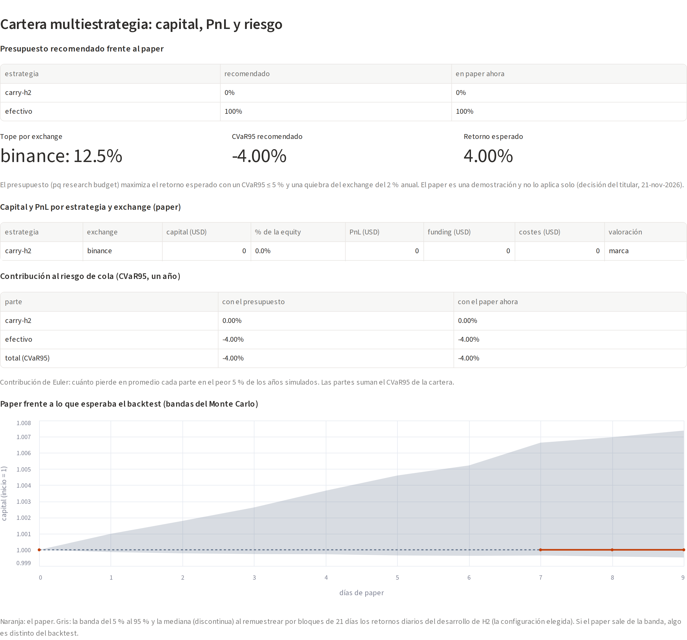

# Dashboard de investigación

Panel de **solo lectura** con los resultados: calidad de los datos, carry y gates, modelo del
funding y simulación. Decisión en [ADR-0009](../adr/0009-streamlit-y-docker-para-el-dashboard.md).

## Abrirlo

**En local:**

```bash
make dashboard          # http://localhost:8501
```

**Con Docker** (Docker Desktop abierto y con la integración WSL, ver KE-008):

```bash
docker compose up --build    # http://127.0.0.1:8501
docker compose down
```

## Modo feria (PQ-102)

Para la pantalla grande de la feria, abre **<http://localhost:8501/?modo=feria>**:

- **Tipografía grande**, pensada para leerse a 2 o 3 metros. Solo usa fuentes del sistema.
- **La pestaña en vivo se actualiza sola** cada 60 s, al ritmo del runner, sin recargar el resto.
- **Recorrido guiado** en la barra lateral: 7 pasos, uno por sección del pitch (PQ-60). Cada paso
  dice qué pestaña abrir, qué decir y qué señalar. Se avanza con «Siguiente ▶».

| Paso | Sección del pitch | Pestaña |
|---|---|---|
| 1 | El problema | (el título del tablero) |
| 2 | Por qué fallan los minoristas | Datos y calidad (técnico) |
| 3 | Nuestra respuesta | ¿Funciona? Carry y gates |
| 4 | La evidencia | ¿Qué riesgo hay? Simulación |
| 5 | Demo en vivo | ¿Cómo va en vivo? Paper trading |
| 6 | Viabilidad | ¿Y si invierto? Simula tu inversión |
| 7 | Cierre | (vuelve a la pestaña en vivo) |

Los textos se editan en `src/prometheus_platform/api/dashboard/tour.py` (`STEPS`). No llevan cifras:
las cifras las muestra el tablero desde los artefactos.

**Sin internet (plan B de PQ-63).** El tablero solo lee el lakehouse local, así que abre y navega con
la red cortada; lo comprueba una prueba que bloquea los sockets. Sin red, el runner no recibe precios
nuevos y la pestaña en vivo muestra el último ciclo con su antigüedad. La pestaña «¿Qué predice
hoy?» necesita los datos de hoy ingeridos antes de perder la conexión.

## Qué muestra

| Pestaña | Pregunta que responde | Artefacto | Se genera con |
|---|---|---|---|
| ¿Qué pasó? | ¿Los datos son confiables? | `data/silver/_quality/*.json` | `uv run pq silver build --symbol <S>` |
| ¿Funciona? | ¿El carry pasa los gates? | `data/research/carry/H*/` | `uv run pq research carry --hypothesis H2 --figures <dir>` |
| ¿Qué predice? | ¿Se puede anticipar el funding? | `data/research/funding_model/summary.json` | `uv run pq research funding-model --figures <dir>` |
| ¿Qué riesgo hay? | ¿Qué puede salir mal? | `data/research/simulation/summary.json` | `uv run pq research simulate --figures <dir>` |
| ¿Y si invierto? | ¿Qué me pasaría con mi capital? | Silver de H2 (desarrollo): Monte Carlo del cap. 6 con tu capital, horizonte y riesgo de quiebra; θ solo pre-registrado | `uv run pq silver build --symbol <S>` |
| ¿Qué predice hoy? | ¿Habrá funding alto en la próxima liquidación? | Clasificador del cap. 5 entrenado con el desarrollo; predice solo con datos **posteriores** al holdout | `uv run pq ingest --source api ...` + `pq silver build` |
| ¿Cómo va en vivo? | ¿Cómo va el paper trading ahora? | `data/paper/diario.jsonl` y `heartbeat.json`: equity frente a lo esperado según el backtest, funding, costes, posiciones, órdenes, decisiones, heartbeat y kill-switch | `uv run pq paper run` ([runbook](paper-trading.md)) |
| ¿Cómo se reparte? | ¿Cómo se reparte el capital y el riesgo entre estrategias? | Presupuesto recomendado frente al paper, capital y PnL por estrategia y exchange, contribución al CVaR95 (con el presupuesto y con el paper ahora) y el paper frente a las bandas del 5 %, la mediana y el 95 % del backtest de H2 | `uv run pq research budget` y `uv run pq paper run` (PQ-84) |

Si falta un artefacto, la pestaña muestra el comando que lo genera.

### La pestaña de cartera (PQ-84)



Captura del 21-nov-2026, con el paper fuera de posición (el carry no ha entrado) y el presupuesto
recomendado al 100 % en efectivo. Las capturas de todas las pestañas se regeneran con
`uv run --group e2e python scripts/capture_dashboard.py --url http://127.0.0.1:8501` en
`reports/storytelling/_img/dashboard/`, que no se versiona.

## Seguridad del contenedor

- `data/` se monta con `:ro`: el panel no puede modificar el lakehouse.
- Root filesystem en solo lectura, usuario `pq` (uid 10001), sin capacidades (`cap_drop: ALL`).
- Puerto publicado solo en `127.0.0.1`: no queda expuesto a la red.
- La imagen no contiene `.env` ni datos (`.dockerignore`).

## Pruebas en navegador y capturas (PQ-41)

[Playwright](https://playwright.dev/python/) abre el dashboard en un Chromium sin ventana, como lo vería
un usuario. Complementa las pruebas de `AppTest` (que ejecutan el script sin navegador) y comprueba lo
que ellas no ven: que el contenedor sirve la página, que todas las pestañas se pueden abrir y que ninguna
muestra un error.

```bash
make e2e            # levanta el contenedor, instala Chromium la primera vez y corre tests/e2e/
make screenshots    # una imagen PNG por pestaña en reports/storytelling/_img/dashboard/
```

- Las pruebas aceptan datos reales o un lakehouse vacío: cada pestaña debe mostrar una tabla o el aviso
  con el comando que genera el artefacto.
- En la CI corren en el job *Imagen Docker del dashboard*, contra el contenedor recién construido.
- Las capturas sirven para el informe y la presentación; quedan fuera de git porque se regeneran.
- El grupo de dependencias `e2e` no se instala por defecto: `uv sync --group e2e`.
