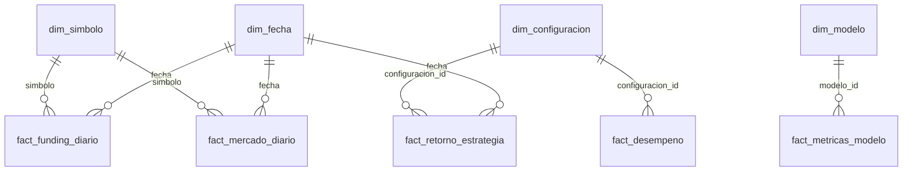

# Plan de implementación: capa gold

- **Ticket:** PQ-46 · **Fecha:** 2026-11-06 · **Spec:** [spec.md](spec.md)

## Contexto técnico

| | |
|---|---|
| Ubicación | `data_platform/gold.py`: gold es una capa del lakehouse, como silver |
| Lectura de research | Solo **archivos** de `data/research/` (JSON y Parquet); no se importa `research`, que es una capa superior |
| Constante del holdout | Se mueve a `domain/protocol.py`; `research/panel.py` la reexporta con el mismo nombre |
| Dependencia nueva | `duckdb` (MIT), prevista en ADR-0003 |
| CLI | `pq gold build` y `pq gold docs --out docs/arquitectura/modelo-gold.md` |

## Modelo en estrella

Hechos sin dimensión de fecha: `fact_gates`, `fact_escenarios`, `fact_frontera` y `fact_calidad`.
Son resultados agregados de una evaluación y no series temporales.

## Verificación contra la «constitución»

| Regla | Cumplimiento |
|---|---|
| ADR-0001 (capas) | `data_platform` no importa `research`; lee sus artefactos como archivos |
| Holdout cerrado | Filtro por `HOLDOUT_START` en cada hecho con fecha, con su test |
| Sin datos inventados | Toda cifra sale de silver o de un artefacto; lo que no existe queda nulo |
| DoD | Tests de esquema, claves, integridad referencial y holdout; documentación generada |

## Riesgos

| Riesgo | Mitigación |
|---|---|
| El esquema de un JSON de research cambia | Lectura tolerante: el hecho queda vacío, el informe lo dice y un test cubre el caso |
| CSV con separador decimal distinto en Power BI (configuración regional) | Documentado en la guía de PQ-47; CSV con punto decimal y UTF-8 |
| `duckdb` aumenta la imagen del dashboard | Es una dependencia de la librería; ~20 MB, aceptable |
